# Bundle Network Utilities

**In short:** these functions turn the *available network* (every path a harness could take) into the *chosen network* (the one path this harness takes). The available network is a massive subset of any possible route this harness could take. Use these functions to distill, modify, and refine the available network to form the chosen network that the harness is built from. 

## Words on this page

- **Network** — a dict with `"nodes"` and `"segments"`.
- **Node** — a point in 3D: a connector, a branch, or a bend. It has a `node_id` and a `location` `[x, y, z]`.
- **Segment** — a run of wire bundle between two points. It has a `segment_id` and two end locations.
- **Available network** — every route the harness could take. Saved in `networks/available.json`. The available network editor shows exactly this file.
- **Chosen network** — the one route this harness takes. Saved in `networks/chosen.json`. The harness is built from it.
- **Needed node** — a node the harness must reach. Usually one per connector, named `<connector_group>.node`.
- **Source of truth** — where a node or segment came from:
    - `"gui"`: you drew it, or the build added it for you to edit. It stays in the file.
    - A routing context, such as `"source physical model.step"` (the source system). The build reloads it fresh every time.

## Where the available network comes from

- You draw it in the available network editor.
- The build reads it from the source system's physical model.
- You import it from CAD with `available_network.source_context_from_path`.
- You copy it from another project with `available_network.source_available_network_from_project`.

## How to call these functions

- Each call returns a **new** network. The one you pass in is not changed.
- Always assign the result back, for example `network = bundle_network_utils.move_node(network, node_id, direction=offset)`.

## Which function does what

- **Building the route:**
    - `end_all_segments_in_nodes`: gives every loose segment end a node.
    - `raise_on_duplicate_node_ids`: stops the build if two nodes share a name.
    - `adopt_mating_connector_nodes`: renames the node where a harness connector plugs into a device to `<connector_group>.node`, turned to face the device.
    - `ensure_nodes_exist`: lists the needed nodes that are missing.
    - `calculate_possible_sub_networks`: lists every route that reaches all the needed nodes. Empty means no route.
    - `find_network_with`: keeps the routes that contain a segment or node you name.
- **Editing the chosen route:** `new_node`, `move_node`, `rename_node`, `reroute_segment`, `clock_backshell`.
- **Placing connectors:**
    - With a backshell: `clock_backshell` turns it toward the next node. It already shifts by the connector mate.
    - Without a backshell: `move_node` with `output_offset(..., "3d-mate")`.
- **Order:** layout moves go after one route is picked and before `chosen_network.save`. Then `flattened_network.derive` makes the flat drawing.

## Coordinate systems

- A coordinate system is a dict: `{x, y, z, alpha, beta, gamma}`.
- `x`, `y`, `z`: the position.
- `alpha`, `beta`, `gamma`: degrees about X, Y, and Z.
- The rotation is `Rx(alpha) · Ry(beta) · Rz(gamma)`. Z is applied first, then Y, then X.
- `output_offset` and `difference_between_csys` return one. Pass it to `move_node` as `direction`.

---
## How the default harness build makes the chosen network

- **Starts with:** `networks/available.json`.
- **Ends with:** `networks/chosen.json` and the flat drawing.
- **Boxes** are steps, numbered [1] to [24]. The table below the diagram uses the same numbers. **Arrows** say why the build moves on.
- **Dashed boxes** are yes-or-no questions. The arrows out of them start with Yes or No.
- **Two loops:**
    - The first places any needed node that is missing.
    - The second connects every needed node into one route.
- **Stop** boxes are where the build fails with an error.

```mermaid
stateDiagram-v2
    Load : [1] Read available.json<br>into memory as the<br><span style='color:red'>available network</span>. A<br>missing file gives an<br>empty available network.
    ReloadContexts : [2] In the<br><span style='color:red'>available network</span>, drop<br>every node and segment<br>that is not gui, then add<br>the source system's mating<br>connectors and routed<br>segments again.
    SaveAvailable : [3] Write the<br><span style='color:red'>available network</span> to<br>available.json.
    CopyToChosen : [4] Read the whole<br><span style='color:red'>available network</span> and copy<br>it into a new<br><span style='color:cyan'>chosen network</span>.
    AdoptMatingConnectors : [5] In the <span style='color:cyan'>chosen network</span>,<br>rename each node at a<br>harness connector's device<br>mating connector to<br>connector_group.node and<br>turn it to face the<br>device. The available<br>network keeps the old<br>name.
    NamesUnique : [6] Read the<br><span style='color:cyan'>chosen network</span>. Is every<br>node name unique?
    EndSegments : [7] In the <span style='color:cyan'>chosen network</span>,<br>give every segment end<br>that is not on a node a<br>new node. The available<br>network is not changed.
    NextNeededNode : [8] Take the next needed<br>node from the<br><span style='color:yellow'>instances list</span>.
    AlreadyInChosen : [9] Read the<br><span style='color:cyan'>chosen network</span>. Does it<br>already have a node with<br>this name?
    PlaceNode : [10] Write the node to<br>both the <span style='color:red'>available network</span><br>and the <span style='color:cyan'>chosen network</span>, at<br>a random spot near the<br>other nodes of the chosen<br>network.
    NeededLeftToCheck : [11] Are any needed nodes<br>left to check?
    TwoOrMoreNeeded : [12] Are there two or more<br>needed nodes?
    MaybeAddHub : [13] When there are more<br>than three connectors, no<br>segments in the<br><span style='color:red'>available network</span>, and no<br>hub, write a hub node to<br>both the <span style='color:red'>available network</span><br>and the <span style='color:cyan'>chosen network</span>.
    StartConnectedNodes : [14] Start the list of<br>connected nodes with hub,<br>or with one needed node<br>picked at random when<br>there is no hub. Shuffle<br>the rest.
    NeededLeftToConnect : [15] Are any needed nodes<br>left to connect?
    AddNextNode : [16] Add the next needed<br>node to the connected<br>nodes.
    RouteFound : [17] Read the<br><span style='color:cyan'>chosen network</span>. Does<br>calculate_possible_sub_networks<br>find a route that joins<br>all the connected nodes?
    AddLeg : [18] Write a gui segment<br>to the new node, from hub<br>or from the nearest<br>connected node, to both<br>the <span style='color:red'>available network</span> and<br>the <span style='color:cyan'>chosen network</span>.
    SaveAvailableAgain : [19] Write the<br><span style='color:red'>available network</span>, with<br>everything the build<br>added, to available.json.
    ExactlyOneRoute : [20] Read the<br><span style='color:cyan'>chosen network</span>. Does<br>calculate_possible_sub_networks<br>find exactly one route<br>that joins all the needed<br>nodes?
    MoveConnectorNodes : [21] In the one route<br>picked from the<br><span style='color:cyan'>chosen network</span>, move each<br>connector node by its<br>backshell clock or its<br>3d-mate offset.
    SaveChosen : [22] Write that route to<br>chosen.json as the<br><span style='color:cyan'>chosen network</span>, and build<br>the flat drawing from it.
    StopDuplicateNames : [23] The build stops with<br>an error that names the<br>duplicate nodes. Nothing<br>more is written.
    StopRouteCount : [24] The build stops with<br>an error that says how<br>many routes it found.<br>Nothing more is written.<br>The user is encouraged to<br>use functions like<br>bundle_network_utils.find_network_with(input_networks,<br>segment_ids=[],<br>node_ids=[]) to approach<br>the desired network.
    [*] --> Load : The harness build<br>reaches its network<br>section.
    Load --> ReloadContexts : The available network<br>is in memory.
    ReloadContexts --> SaveAvailable : The available network<br>has fresh source<br>system items.
    SaveAvailable --> CopyToChosen : available.json matches<br>the available network.
    CopyToChosen --> AdoptMatingConnectors : The chosen network has<br>every node and segment<br>of the available<br>network.
    AdoptMatingConnectors --> NamesUnique : Connector nodes in the<br>chosen network have<br>their harness names.
    NamesUnique --> StopDuplicateNames : No. Two nodes share a<br>name.
    NamesUnique --> EndSegments : Yes.
    EndSegments --> NextNeededNode : Every segment in the<br>chosen network ends on<br>a node.
    NextNeededNode --> AlreadyInChosen : There is a needed node<br>to check.
    AlreadyInChosen --> NeededLeftToCheck : Yes. Nothing to add.
    AlreadyInChosen --> PlaceNode : No. It is missing.
    PlaceNode --> NeededLeftToCheck : The node is in both<br>the available network<br>and the chosen<br>network.
    NeededLeftToCheck --> NextNeededNode : Yes.
    NeededLeftToCheck --> TwoOrMoreNeeded : No. Every needed node<br>is checked.
    TwoOrMoreNeeded --> NeededLeftToConnect : No. There is nothing<br>to connect.
    TwoOrMoreNeeded --> MaybeAddHub : Yes.
    MaybeAddHub --> StartConnectedNodes : A hub exists if this<br>harness needs one.
    StartConnectedNodes --> NeededLeftToConnect : The list has its first<br>node.
    NeededLeftToConnect --> AddNextNode : Yes.
    NeededLeftToConnect --> SaveAvailableAgain : No. Every needed node<br>is connected.
    AddNextNode --> RouteFound : One more needed node<br>is on the list.
    RouteFound --> NeededLeftToConnect : Yes. The new node is<br>already connected.
    RouteFound --> AddLeg : No. The new node is<br>not connected yet.
    AddLeg --> NeededLeftToConnect : The new node is now<br>connected in both the<br>available network and<br>the chosen network.
    SaveAvailableAgain --> ExactlyOneRoute : available.json holds<br>everything the build<br>added.
    ExactlyOneRoute --> StopRouteCount : No. There are zero<br>routes, or more than<br>one.
    ExactlyOneRoute --> MoveConnectorNodes : Yes.
    MoveConnectorNodes --> SaveChosen : Connector nodes sit at<br>their mating faces.
    SaveChosen --> [*] : chosen.json and the<br>flat drawing are on<br>disk.
    classDef question stroke-dasharray: 5 5
    class NamesUnique,AlreadyInChosen,NeededLeftToCheck,TwoOrMoreNeeded,NeededLeftToConnect,RouteFound,ExactlyOneRoute question
```

| Block | State | What happens | What is written |
| --- | --- | --- | --- |
| 1 | **Load** | ``available_network.load()`` reads ``available.json``. A missing file is an empty network. | Nothing. |
| 2 | **ReloadContexts** | ``keep_only_gui`` drops every node and segment that is not ``"gui"``. The source system's mating connector nodes and routed segments are added again, fresh, tagged ``"source physical model.step"``. | Nothing yet. |
| 3 | **SaveAvailable** | ``available_network.save`` writes the available network. | ``available.json`` |
| 4 | **CopyToChosen** | The chosen network starts as a copy of the whole available network. | Nothing. |
| 5 | **AdoptMatingConnectors** | A node named after the device mating connector a harness connector plugs into (``<device_side_refdes>.<device_side_connector_id>``), whatever its source of truth, becomes ``<connector_group>.node``, turned 180° to face the device. Chosen network only. | Nothing. |
| 6 | **NamesUnique** | ``raise_on_duplicate_node_ids`` reads the chosen network. Two nodes with one name, whatever their source of truth, stop the build. | Nothing. |
| 7 | **EndSegments** | ``end_all_segments_in_nodes`` gives every free segment end a node. Chosen network only. | Nothing. |
| 8 | **NextNeededNode** | First loop. Takes each needed node (an instance with ``item_type`` ``"node"``) from the instances list, in turn. | Nothing. |
| 9 | **AlreadyInChosen** | Reads the chosen network to see whether it already has a node with that name. | Nothing. |
| 10 | **PlaceNode** | Adds the missing node to both the available network and the chosen network as ``"gui"``, 6 to 18 inches from the average location of the chosen nodes, at a random angle in XY. | Nothing yet. |
| 11 | **NeededLeftToCheck** | The first loop repeats until every needed node is checked. | Nothing. |
| 12 | **TwoOrMoreNeeded** | A harness with fewer than two needed nodes (one connector) has nothing to connect. It skips the hub and the list, and the next question answers No. | Nothing. |
| 13 | **MaybeAddHub** | With more than three connectors, no segments in the available network, and no ``hub`` yet, a ``hub`` node is added to both the available network and the chosen network as ``"gui"``, at the average location of the needed nodes. | Nothing yet. |
| 14 | **StartConnectedNodes** | The list of connected nodes (needed nodes that one route already joins) starts with ``hub`` when there is one, otherwise with one needed node picked at random. The rest are shuffled. | Nothing. |
| 15 | **NeededLeftToConnect** | The second loop repeats until every needed node is connected. | Nothing. |
| 16 | **AddNextNode** | Second loop. The next needed node is added to the connected nodes. | Nothing. |
| 17 | **RouteFound** | ``calculate_possible_sub_networks(chosen, connected_nodes)`` reads the chosen network and looks for a route that joins all the connected nodes. | Nothing. |
| 18 | **AddLeg** | A ``"gui"`` segment named ``<new node>_leg`` goes into both the available network and the chosen network: from ``hub`` when there is one, otherwise from the nearest node already connected. | Nothing yet. |
| 19 | **SaveAvailableAgain** | ``available_network.save`` writes the available network with every node and segment added above, so the next build reuses them. A harness with fewer than two needed nodes (one connector) comes straight here. | ``available.json`` |
| 20 | **ExactlyOneRoute** | ``calculate_possible_sub_networks(chosen, needed_nodes)`` reads the chosen network and lists the routes. ``find_network_with`` can narrow them to the one with a preferred segment or node. Anything but exactly one route stops the build. | Nothing. |
| 21 | **MoveConnectorNodes** | Each connector node is moved by its backshell clock or by its connector's ``3d-mate`` offset. Chosen network only. | Nothing. |
| 22 | **SaveChosen** | ``chosen_network.save`` writes the one route. ``flattened_network.derive`` then builds the flat drawing from it. | ``chosen.json``, ``flat.csv`` |
| 23 | **StopDuplicateNames** | The build raises an error that names the duplicate nodes and their sources of truth. | Nothing more. |
| 24 | **StopRouteCount** | The build raises an error that says how many routes it found. The user is encouraged to use functions like ``bundle_network_utils.find_network_with(input_networks, segment_ids=[], node_ids=[])`` to approach the desired network. | Nothing more. |

---
##Commands
*These functions are already available in build instructions as `bundle_network_utils`. Use them as written.*
??? info "`bundle_network_utils.compose_csys(*csys_list)`"

    Use this when a harness build needs one pose made by stacking child coordinate systems.
    
    Compose child CSYS dicts left to right.
    
    Each next CSYS is expressed in the previous CSYS's frame. Returns
    ``{x, y, z, alpha, beta, gamma}`` in the first CSYS's parent frame.
    
    **Args:**
    - `csys_list`: One or more child CSYS dicts, in order from parent to child. Each dict may include ``x``, ``y``, ``z``, ``alpha``, ``beta``, and ``gamma``. Pass them as separate positional arguments. Optional; with none, the result is the origin with no rotation.

??? info "`bundle_network_utils.invert_csys(csys)`"

    Use this when a harness build needs the opposite of a child coordinate system.
    
    Return the opposite of a child CSYS.
    
    The result takes the child frame back to its parent origin: if ``csys``
    is a connector mate relative to the part origin, ``invert_csys(csys)``
    is the shift that puts that mate on the origin.
    
    **Args:**
    - `csys`: Child CSYS dict ``{x, y, z, alpha, beta, gamma}``, expressed in its parent frame. The result is the opposite shift, the one that brings that child frame back to the parent origin.

??? info "`bundle_network_utils.difference_between_csys(instance, from_csys, to_csys)`"

    Use this when a harness build needs the move from one coordinate system to another before passing it to move_node.
    
    Direction that takes ``to_csys`` onto ``from_csys``.
    
    Pass the result to ``move_node`` as the move direction. Typical use:
    keep a connector mating face on the original available-network point
    with ``from_csys="origin"`` and ``to_csys="3d-mate"``.
    
    **Args**
    
    - **instance** — Instance dict, ``instance_name``, or ``connector_group``.
      Named children may live on different items in the same group; the
      parent CSYS stack is composed (backshell ``3d-connector``, each
      instance ``3d_translate``, then connector ``3d-mate``).
    - **from_csys** — Child name or ``"origin"``. This is where ``to_csys``
      should land.
    - **to_csys** — Child name or ``"origin"``. The CSYS that moves.
    
    **Returns**
    
    A CSYS dict ``{x, y, z, alpha, beta, gamma}`` in the node frame.

??? info "`bundle_network_utils.calculate_location_3d(lookup_instance, instances)`"

    Use this when a harness build needs an instance's world pose from the chain of parent coordinate systems.
    
    Calculates the 3D world pose of an instance from the CSYS chain.
    
    Same walk and order as ``flattened_network.calculate_location``: origin of
    the master file is ``(0, 0, 0)``, then each parent CSYS along the chain.
    At every link:
    
    1. Parent output CSYS offset is applied in the current (parent) frame.
    2. Parent output CSYS rotation is composed on.
    3. Instance ``3d_translate`` ``{x, y, z, alpha, beta, gamma}`` is applied
       in that same frame, then its rotation is composed on. When
       ``3d_translate`` is blank, ``2d_translate`` ``{x, y, rotate}`` is used
       (``rotate`` about Z, like 2D).
    
    Angles are ZYX Euler degrees matching the console node triad
    (``α`` about X, ``β`` about Y, ``γ`` about Z;
    ``R = Rx(alpha) · Ry(beta) · Rz(gamma)``). Each link's rotation is
    composed onto the next so a child inherits every ancestor heading.
    A 2D ``csys_children`` ``rotation`` is about drawing Z, so it becomes
    ``gamma``. ``absolute_rotation`` is the 2D formboard heading and is
    not applied here.
    
    Args:
        lookup_instance (dict): The instance dictionary to calculate coordinates for.
        instances (list): List of all instance dictionaries needed to resolve the parent chain.
    
    Returns:
        tuple: ``(x, y, z, alpha, beta, gamma)`` in the same units as ``3d_translate``
            (inches) and degrees.
    
    Raises:
        ValueError: If parent coordinate system information is missing or invalid, or
            if parent instances cannot be found in the instances list.

??? info "`bundle_network_utils.move_node(input_network, node_id, direction=None, new_location=None, new_rotation=None, output_csys=None)`"

    Use this when a harness build needs one node of the chosen network moved, along with the segment ends that sit on it.
    
    Moves one node in a network.
    
    **Args**
    
    - **input_network** — Network dict with ``"segments"`` and ``"nodes"``.
    - **node_id** — Which node in the network to move.
    - **direction** — Which way to move it: a CSYS dict in the node's
      current frame, usually from ``difference_between_csys``. Segment
      endpoints that sit on the old location follow the node. Optional.
      Omit this when you pass ``new_location``.
    - **new_location** — Absolute world position ``[x, y, z]``. Use this
      instead of ``direction`` when you already know the destination.
      Segment endpoints on the old location follow the node. Optional.
    - **new_rotation** — Absolute ``[alpha, beta, gamma]`` in degrees,
      applied together with ``new_location``. Ignored when ``direction``
      or ``output_csys`` is set. Optional.
    - **output_csys** — Alias for ``direction``: a CSYS dict in the node's
      current frame. Optional.
    
    **Returns**
    
    A deep copy of ``input_network`` with the node and its incident
    segment geometry updated.
    
    **Errors**
    
    - **ValueError** if the node is missing, or if no direction or
      ``new_location`` is given.

??? info "`bundle_network_utils.adjacent_nodes(input_network, from_node)`"

    Use this when a harness build needs the nodes one segment away from a given node.
    
    Traverses the network from a given node and returns a list of dicts representing nodes that are one segment of connection away.
    
    The dict should contain node_id, delta_x, delta_y, and delta_z.
    
    Deltas are calculated by finding the relative position of each node with respect to the from_node coordinate system.
    
    **Args**
    
    - **input_network** — Network dict to traverse. Segments connect nodes that share an endpoint location.
    - **from_node** — Node dict to start from. It needs ``location``. Include ``alpha``, ``beta``, and ``gamma`` when deltas should be in that node's frame; if any angle is missing, deltas are in global coordinates.

??? info "`bundle_network_utils.path_angle(input_network, node_id, toward='incident', axis='x', zero='y', if_along_axis=None)`"

    Use this when a harness build needs the angle of one hop away from a node, in that node's frame.
    
    Angle of a hop in a node's frame, in degrees ``[0, 360)``.
    
    ``θ`` is the right-hand angle from ``zero`` to the hop, about ``axis``.
    Defaults match a clock about +X from +Y: ``atan2(z, y)``.
    
    **Args:**
    - `input_network` (dict): Network with ``"segments"`` and ``"nodes"``.
    - `node_id` (str): Node whose frame is used.
    - `toward` (str): ``"incident"`` for the unique neighbor, or a node id.
    - `axis` (str): ``"x"``, ``"y"``, or ``"z"``.
    - `zero` (str): Axis that is θ = 0.
    - `if_along_axis`: If the hop is along ``axis``, return this instead of
        raising (use ``0`` for a straight exit).
    
    **Returns:**
    - `float`: Angle in degrees.
    
    **Raises:**
    - `ValueError`: If the hop cannot be resolved, or is along ``axis`` when
        ``if_along_axis`` is omitted.

??? info "`bundle_network_utils.output_csys(instance, csys_name)`"

    Use this when a harness build needs a named output coordinate system on one instance, without walking its parents.
    
    Named output CSYS on one instance (no parent-chain walk).
    
    **Args:**
    - `instance`: Instance dict, instance name, or connector group.
    - `csys_name` (str): Child name (``"3d-mate"``, ``"connector"``, …).
    
    **Returns:**
    - `dict`: ``{x, y, z, alpha, beta, gamma}``.
    
    **Raises:**
    - `ValueError`: If the instance or CSYS is missing.

??? info "`bundle_network_utils.output_offset(instance, csys_name, about=None, angle=0)`"

    Use this when a harness build needs the node move taken from one output coordinate system, such as a connector's 3d-mate.
    
    Node move taken from one instance output CSYS.
    
    ``invert(output)``, then optionally ``rotate_csys`` about ``about``.
    Pass the result to ``move_node``. This is any part's "how far is the
    origin from this feature," not a connector-only helper.
    
    **Args:**
    - `instance`: Instance dict, instance name, or connector group.
    - `csys_name` (str): Child name on that instance.
    - `about` (str): ``"x"``, ``"y"``, or ``"z"`` to spin the offset.
    - `angle` (float): Degrees about ``about``. Ignored if ``about`` is blank.
    
    **Returns:**
    - `dict`: CSYS in the current node frame.

??? info "`bundle_network_utils.rotate_csys(csys, angle, about='x')`"

    Use this when a harness build needs a child coordinate system rotated about one parent axis.
    
    Rotate a child CSYS about a parent axis.
    
    ``R = R_about(angle) · csys`` in the parent frame.
    
    **Args:**
    - `csys` (dict): ``{x, y, z, alpha, beta, gamma}`` or a library child.
    - `angle` (float): Rotation in degrees, applied in the parent frame before the CSYS's own rotation.
    - `about` (str): ``"x"``, ``"y"``, or ``"z"``.
    
    **Returns:**
    - `dict`: The rotated CSYS.

??? info "`bundle_network_utils.spin(instance_name, angle, about='x')`"

    Use this when a harness build needs one rotation component written on an instance, such as un-clocking a connector after clocking its backshell.
    
    Write one Euler component of ``3d_translate`` on an instance.
    
    Use the opposite of a ``path_angle`` when a child should not inherit a
    parent spin (un-clock a connector after a clocked backshell move).
    
    **Args:**
    - `instance_name` (str): Instance to rotate in its parent CSYS.
    - `angle` (float): Rotation in degrees about the axis given by ``about``.
    - `about` (str): ``"x"`` → ``alpha``, ``"y"`` → ``beta``, ``"z"`` → ``gamma``.
    
    **Returns:**
    - `float`: The angle written, normalized to ``[0, 360)``.
    
    **Raises:**
    - `ValueError`: If the name is blank, the instance is missing, or the
        angle is not a finite number.

??? info "`bundle_network_utils.clock_backshell(network, connector_group, towards_node='incident', round_to_nearest_angle=None)`"

    Use this when a harness build needs a backshell clocked on its connector group toward another node.
    
    Clock a backshell on ``connector_group`` and un-clock its connector.
    
    1. ``θ = path_angle`` from the group node toward ``towards_node``.
    2. ``move_node`` by the connector ``3d-mate`` output offset.
    3. ``move_node`` by the backshell ``connector`` output offset, spun about X
       by θ (snapped if ``round_to_nearest_angle`` is set).
    4. ``spin`` the connector by ``-θ`` so the mate keeps its orientation.
    5. Apply a ``build_note`` on the connector. Connector up is +Y, so the
       shop clock starts at +Y, not +X: clockwise from the mating face is
       ``90° - θ``.
    
    **Args:**
    - `network` (dict): Chosen network, still at available poses.
    - `connector_group` (str): Group that owns the node, connector, and backshell.
    - `towards_node` (str): Neighbor to aim at, or ``"incident"`` for the
        unique hop. Defaults to ``"incident"``.
    - `round_to_nearest_angle` (float): If set, snap θ to this many degrees
        (detents). Omit or ``None`` to keep the raw angle.
    
    **Returns:**
    - `dict`: Updated network.
    
    **Raises:**
    - `ValueError`: If the group, connector, backshell, or hop cannot be found.

??? info "`bundle_network_utils.rename_node(input_network, new_id, existing_id=None, coordinates=[])`"

    Use this when a harness build needs a node's id changed in the chosen network.
    
    Finds a node and changes its id.
    
    If existing ID is used, that's self-explanatory.
    
    If coordinates are given in form {x, y, z, radius} and not 1 node is in the sphere, raise an error.
    
    **Args**
    
    - **input_network** — Network dict. A copy is returned; the input is not modified.
    - **new_id** — ``node_id`` to assign to the found node.
    - **existing_id** — Current ``node_id`` to rename. Use this or ``coordinates``. Optional.
    - **coordinates** — ``[x, y, z, radius]``. Renames the single node inside that sphere. Raises unless the sphere contains exactly one node. Optional. Pass ``existing_id`` or ``coordinates``.

??? info "`bundle_network_utils.delete_node(input_network, node_id)`"

    Use this when a harness build needs a node removed from a network, such as before adding a fresh copy of it.
    
    Removes every node with that ``node_id``. Segments are not changed, so a
    segment end that sat on the node keeps its location.
    
    **Args**
    
    - **input_network** — Network dict. A copy is returned; the input is not modified.
    - **node_id** — ``node_id`` to remove. A missing node is not an error.

??? info "`bundle_network_utils.delete_segment(input_network, segment_id)`"

    Use this when a harness build needs a segment removed from a network, such as before adding a fresh copy of it.
    
    Removes every segment with that ``segment_id``. Nodes are not changed.
    
    **Args**
    
    - **input_network** — Network dict. A copy is returned; the input is not modified.
    - **segment_id** — ``segment_id`` to remove. A missing segment is not an error.

??? info "`bundle_network_utils.adopt_mating_connector_nodes(input_network, flip=True, instances=None, replace_existing=True)`"

    Use this when a harness build's available network has a node at each device mating connector its harness connectors plug into, such as the nodes a system build writes from its physical model.
    
    Turns the node at each device mating connector into the node of the harness connector that plugs into it.
    
    In the physical model, a device has mating connectors. A system build
    writes one available-network node at each placed mating connector, named
    ``<device_refdes>.<mating_connector_id>``. For each ``harness_connector``
    instance, the node named
    ``<device_side_refdes>.<device_side_connector_id>`` is renamed to
    ``<connector_group>.node``. A node at a point shared by several mating
    connectors (``{A.J1+B.J2}``) is matched by any of them. Location and
    segments stay where they are.
    
    A mating connector's +X points out of the device face. A harness connector's
    +X points from its cable side toward its mating face, into the device.
    With ``flip``, the node is turned 180° about its Z axis so a later
    ``move_node`` by ``output_offset(connector, "3d-mate")`` moves the node
    away from the device, not into it.
    
    **Args**
    
    - **input_network** — Network dict. A copy is returned; the input is not modified.
    - **flip** — Turn each adopted node 180° about its own Z axis. Optional; defaults to ``True``.
    - **instances** — Instance rows to read. Optional; defaults to ``instances_list.read()``.
    - **replace_existing** — What to do when ``<connector_group>.node`` is already a different node. ``True`` (the default): the mating connector wins, with a warning; segment ends on that node move to the mating connector's location, and that node is dropped. ``False``: rename anyway and leave both nodes, so ``raise_on_duplicate_node_ids`` reports the clash.
    
    **Returns**
    
    A deep copy of ``input_network`` with the adopted nodes renamed and turned.
    
    A connector with no node at its mating connector is skipped.

??? info "`bundle_network_utils.connect_required_nodes(input_network, required_node_ids, rng=None)`"

    Use this when a harness build needs every required node in the chosen network, connected, after the available network and any adopted mating connector nodes are in.
    
    Adds geometry for required nodes the network does not route to yet.
    
    - A required node that is missing gets a node on a random spoke, 6 to 18
      inches from the anchor in the XY plane, and a ``<node_id>_leg`` segment
      to the anchor.
    - A required node with no segment gets a straight ``<node_id>_leg``
      segment to the anchor. Its location does not change.
    
    The anchor is the first node joined by segments to a required node.
    Without one, it is the node ``hub`` if the network has it. Otherwise a new node is
    added: ``far``, 4 inches in -X of the only required node, when exactly
    one node is required, or ``hub`` at the origin. Nodes and segments that
    are already connected are not changed.
    
    Use it on the network the build turns into the chosen network. It does
    not write ``available.json``, so generated geometry shows up only in the
    chosen network.
    
    **Args**
    
    - **input_network** — Network dict. A copy is returned; the input is not modified.
    - **required_node_ids** — ``node_id`` values the chosen network must contain.
    - **rng** — ``random.Random`` used for spoke placement. Optional; defaults to the ``random`` module.
    
    **Returns**
    
    A deep copy of ``input_network`` with the generated nodes and segments added.

??? info "`bundle_network_utils.average_location(nodes)`"

    Use this when a harness build needs the middle of a set of nodes, such as where to place a new node near them.
    
    Return the average ``[x, y, z]`` of the nodes' locations.
    
    **Args**
    
    - **nodes** — List of node dicts, each with a ``location``. An empty list returns ``[0.0, 0.0, 0.0]``.

??? info "`bundle_network_utils.new_node(input_network, new_id, new_location=[], new_rotation=[], csys=None)`"

    Use this when a harness build needs a node added at a location in the chosen network.
    
    Adds a node at a location.
    
    **Args**
    
    - **input_network** — Network dict. A copy with the new node appended is returned.
    - **new_id** — ``node_id`` for the new node.
    - **new_location** — ``[x, y, z]`` world position. Optional; defaults to an empty location.
    - **new_rotation** — ``[alpha, beta, gamma]`` in degrees. Angles you omit are left unset. Optional.
    - **csys** — CSYS dict stored on the node. Optional; omit it to leave the node without a ``csys``.

??? info "`bundle_network_utils.end_all_segments_in_nodes(input_network, proximity_threshold=1e-06)`"

    Use this when a harness build needs every segment end closed on a node in the chosen network.
    
    Give every segment end a node, and reject two different nodes at one location or two segments on the same endpoints.
    
    **Behavior**
    
    - Verifies that each line or spline ends at the location of a node.
    - If two nodes share the same location and the same name, deletes one of them.
    - Mating-connector nodes that share a location become one node. Its id is
      ``{nodea+nodeb}``, with the connector ids in order, unless one of them
      was renamed by ``adopt_mating_connector_nodes``: then it keeps that
      name. A mating-connector node alone at its location is left as it is. A fasten record is
      not consulted: only the locations matter. A node is a mating-connector
      node when it carries ``mate`` or ``mates``.
    - If a segment endpoint has no matching node, creates one named `f"N{segment_id}A"` or `f"N{segment_id}B"` depending on which end is unmatched.
    
    **Errors**
    
    - **Duplicate node:** raises `ValueError` if two nodes share the same location and they are not both mating-connector nodes.
    - **Duplicate segment:** raises `ValueError` if two segments share the same pair of endpoints.
    
    **Args**
    
    - **input_network** — Network dict with `"segments"` and `"nodes"` keys.
    - **proximity_threshold** — Max distance between two points to be considered the same location. Defaults to `1e-6`.
    
    **Returns**
    
    A deep copy of `input_network` with deduplication applied and any missing nodes added.

??? info "`bundle_network_utils.raise_on_duplicate_node_ids(input_network)`"

    Use this when a harness build needs every node name in the chosen network to be unique, whatever each node's source of truth.
    
    Raise ``ValueError`` when two nodes share a ``node_id``. The message
    names each duplicate and describes every copy: its ``source_of_truth``,
    and, for a mating connector node that
    ``adopt_mating_connector_nodes`` renamed, the name it has in the
    available network. That tells you which copy to rename or delete there.
    
    **Args**
    
    - **input_network** — Network dict with a ``"nodes"`` list. Not modified.

??? info "`bundle_network_utils.ensure_nodes_exist(input_network, set_of_required_nodes)`"

    Use this when a harness build needs the required node ids that are still missing from a network.
    
    Return the required node ids that are not in the network.
    
    The network is not modified. Missing ids come back in first-seen order.
    
    **Args**
    
    - **input_network** — Network dict with a ``"nodes"`` list. Each node needs a ``node_id``. The network is not modified.
    - **set_of_required_nodes** — Node ids that must already be in the network. The return value is the ids from this list that are missing, in first-seen order.

??? info "`bundle_network_utils.calculate_possible_sub_networks(input_network, set_of_required_nodes)`"

    Use this when a harness build needs every minimal route that joins a set of required nodes.
    
    Return every minimal subnetwork that joins all of the required nodes.
    
    Connected segments means segments that share endpoint locations.
    
    A node is said to be connected to a segment if the node's location equals a segment's endpoint.
    
    A "solution" is when a set of segments is found that connects all nodes in the set of required nodes.
    
    There can be zero, one, or many solutions. The output of this function should be a list of network dictionaries that are solutions.
    
    If no solution is found, the list is empty.
    
    When exactly one node is required, every segment that leaves that node is kept, with the node at its other end. That other node does not have to be an instance. A lone connector still carries its available-network stub. Zero required nodes still return no segments.
    
    **Args**
    
    - **input_network** — Network dict with ``"segments"`` and ``"nodes"``. A segment is connected to a node when they share an endpoint location.
    - **set_of_required_nodes** — Node ids one subnetwork must connect. Raises if any id is missing from the network. Returns a list of network dicts, one per minimal solution, or an empty list when no subnetwork connects them.

??? info "`bundle_network_utils.find_network_with(input_networks, segment_ids=[], node_ids=[])`"

    Use this when a harness build got more than one route and needs the one that contains a segment id or a node id the user named. Both id lists empty matches nothing.
    
    Keep the networks that contain any listed segment id or any listed node id.
    
    A network of segments A, B, C and a network of segments C, D, E:
    
    - ``segment_ids=["A"]`` keeps the first network.
    - ``segment_ids=["B", "E"]`` keeps both.
    - ``segment_ids=["C"]`` keeps both.
    - ``segment_ids=["F"]`` keeps nothing.
    
    Both ``segment_ids`` and ``node_ids`` empty matches nothing. Call this
    only when more than one solution came back and a stable id was named.
    
    **Args**
    
    - **input_networks** — List of network dicts to filter.
    - **segment_ids** — Segment ids to look for. A network is kept when it contains any of these. Optional; pass an empty list to ignore segments.
    - **node_ids** — Node ids to look for. A network is kept when it contains any of these or any of ``segment_ids``. Optional; pass an empty list to ignore nodes. If both lists are empty, nothing matches.

??? info "`bundle_network_utils.reroute_segment(input_network, existing_endpoint_node_name, new_endpoint_node_name)`"

    Use this when a harness build needs a segment that ends on one node moved onto a new node.
    
    Moves a segment that ends at an existing node to the coordinates of a new node.
    
    **Args**
    
    - **input_network** — Network dict. A copy is returned; the input is not modified.
    - **existing_endpoint_node_name** — ``node_id`` whose location is a segment endpoint to move. The node must already exist.
    - **new_endpoint_node_name** — ``node_id`` whose location becomes that endpoint. The node must already exist. Every segment end sitting on the old node's location is moved.

